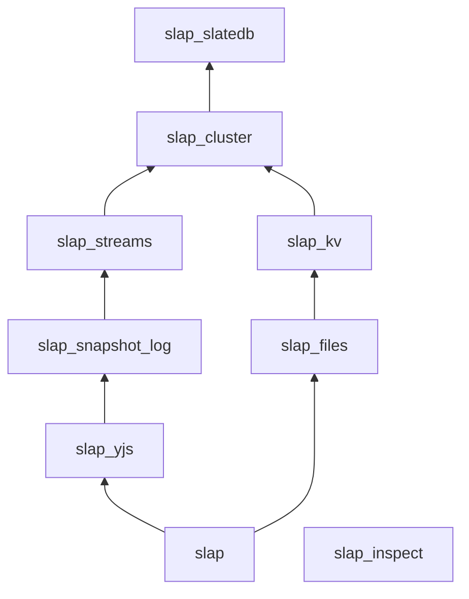
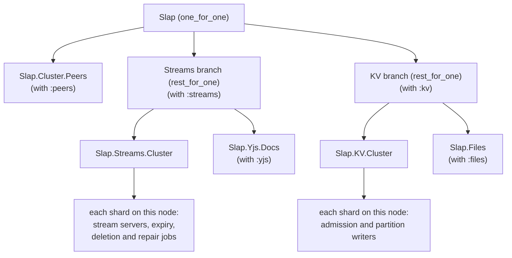
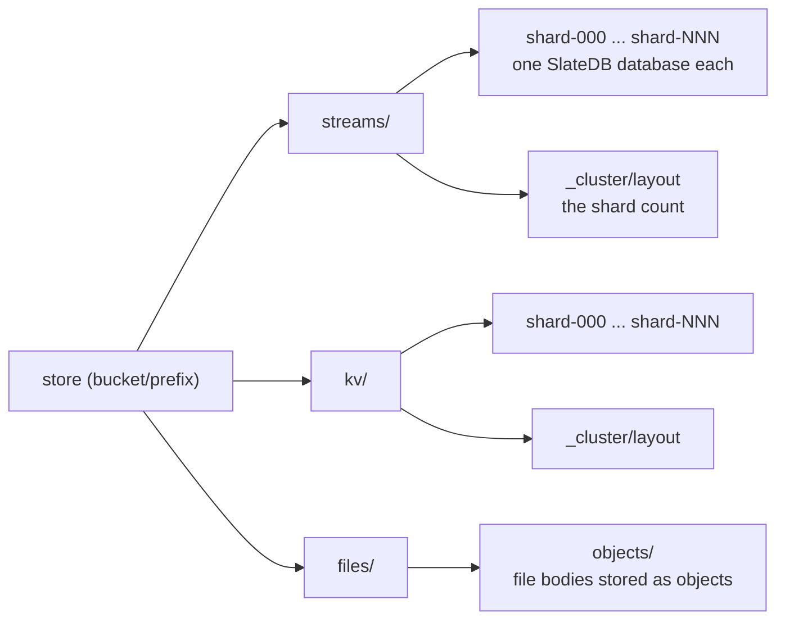

# Architecture

Slap's built-in services use two clusters: Streams and KV. Each is a
`Slap.Cluster`, a set of SlateDB databases called shards. The cluster
assigns its shards to Erlang nodes (VMs).

Each cluster uses one store for its data. A store is an object-store bucket
(optionally under a prefix), a local directory, or memory. The services
use these clusters as follows:

| Package | Runs on | Setup |
| --- | --- | --- |
| `slap_streams` | Streams cluster | `streams: [...]` |
| `slap_snapshot_log` | Streams cluster | `streams: [...]`; no additional `Slap` option |
| `slap_yjs` | Streams cluster | `yjs: [...]`, which requires `streams:` |
| `slap_kv` | KV cluster | `kv: [...]` |
| `slap_files` | KV cluster, and an object store for file bodies | `files: [...]`, which requires `kv:` |

A node can participate in at most one Streams cluster and one KV cluster.
Each cluster can span several nodes; each node opens only its assigned
shards. Start only the clusters your services need: each has its own
databases, placement strategy and background jobs.

Snapshot logs need no separate child under `Slap`: the `slap_snapshot_log`
OTP application starts their recovery process.

## Package dependencies

`slap` depends on the seven server libraries. `slap_inspect` depends on
none of them: it reads a running node's data over distributed Erlang.

Each arrow points from a package to one it depends on. An arrow is left
out when a longer path already connects the two packages: for example,
`slap` also depends on `slap_streams` and `slap_kv` directly, and every
server library depends on `slap_slatedb`.

## Processes

`{Slap, opts}` starts a supervisor with one branch per cluster. A branch
starts its cluster first, then the services that use it, with the
`:rest_for_one` strategy: if a cluster restarts, the services after it
restart too. The two branches restart independently.

Each node runs the shards that the placement strategy assigns to it. A
shard's processes are the only writers of its database. A request for a
shard on another node is served on that node.

## Store layout

Both clusters use the store passed to `Slap`. Their paths default to
`streams/` and `kv/`; set `:path` in a cluster's options or application
config to change them. File objects default to `files/` in the same store.
The diagram shows this default layout:

`files: [store: store, path: path]` selects a separate store or path for
file objects. Inline file bodies and file metadata remain in the KV cluster.

The shard count is recorded in `_cluster/layout` when a cluster first
starts, and is fixed for the life of the data. With the
`Slap.Cluster.Strategy.ObjectLease` placement, each cluster also keeps its
leases under `_cluster/placement/`.

## Custom clusters

`Slap` starts the built-in cluster modules, `Slap.Streams.Cluster` and
`Slap.KV.Cluster`. An application can instead define its own, with
`use Slap.Streams.Cluster, otp_app: :my_app` or
`use Slap.KV.Cluster, otp_app: :my_app`, and supervise them and the
services on them itself, in the order above. Pass `cluster:` to
`Slap.Yjs.Docs`, `Slap.Files` and the operations that use the cluster. The
rule of one Streams cluster and one KV cluster per node still applies.
